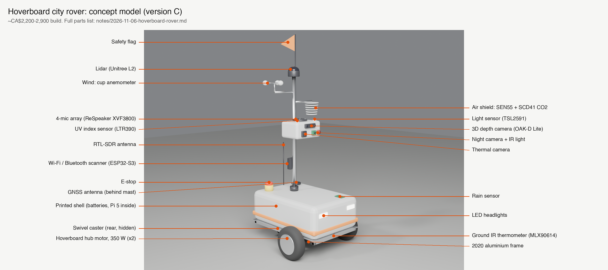

# Hoverboard city rover: parts and sensors (version C)

Status: parts list for Nick's review, 2026-11-06. Nothing bought, nothing built.



Model: [blender/build_hoverboard_rover.py](../blender/build_hoverboard_rover.py) (run headless, see the docstring), then `python3 label_render.py` for the labels.

## TL;DR

The cheapest real robot that can drive through a city and carry weight: a used hoverboard's
hub motors, battery and mainboard, reflashed with open firmware and driven by a Raspberry Pi
over serial. Frame from aluminum extrusion, covers printed on the P1S. With Nick's sensor list
it comes to about **CA$2,200 to 2,900**, against about CA$34,000 for version A.

It is the hardware for version B: drive commands go out over serial, so logging them next to
the camera video is straightforward.

```
Base rover (drives, carries, stays safe)  ████████████   ~CA$1,000-1,500
Sensor pack                               █████████      ~CA$  700-900
+ lidar (Unitree L2)                      █████          ~CA$  480
Total                                                    ~CA$2,200-2,900
```

Prices: unmarked ones come from web searches on 2026-11-06 or from the version A design doc.
Prices marked **est.** are estimates and need checking before buying.

## Why a hoverboard

| Option | Price | Payload | City-capable |
|---|---|---|---|
| **Hoverboard DIY** | ~CA$300-600 base | 50-100 kg est. (built to carry a rider) | Yes: 350 W hub motors, pneumatic or solid tires, 36 V battery included |
| Dagu Wild Thumper 6WD | ~US$235-325 | 5 kg | Rough ground yes, traffic and curbs no |
| Waveshare UGV Rover | ~US$245+ | small | Sidewalk only |
| Rover Robotics 4WD Pro | ~CA$13,500 | 80 kg | Yes (budget option in version A) |
| AgileX Scout 2.0 | ~CA$20,800 | ~50 kg | Yes (version A) |

No published payload rating for a hoverboard robot was found; the figure above is inferred from
hoverboards carrying a person.

## A. Base rover

| # | Part | Pick | Price (CAD) |
|---|---|---|---|
| A1 | Wheels, motors, battery, controller | Used hoverboard with an STM32 mainboard | 50-150 est. |
| A2 | Flashing | ST-Link programmer, `hoverboard-firmware-hack` | ~15 est. |
| A3 | Frame | 2020 aluminum extrusion, plates, caster wheel (or a second board for 4WD) | 130-180 est. |
| A4 | Body | Covers and mounts printed on the P1S | ~50 filament |
| A5 | Brain | Raspberry Pi 5 (already owned). The OAK-D runs vision on its own chip, so a Jetson is optional. Upgrade: Jetson Orin Nano Super, US$249 list, US$370-410 at some retailers | 0-120 |
| A6 | Storage | 1 TB NVMe | ~100 est. |
| A7 | Power | 36 V to 12 V and 5 V buck converters, fuses | ~50 est. |
| A8 | Second battery | Stock pack gives about 1-1.5 h with everything on | 150-250 est. |
| A9 | Position | u-blox M9N GNSS first, RTK later | ~60 est. |
| A10 | Motion | BNO085 IMU | ~35 est. |
| A11 | Safety | RC transmitter and receiver for manual drive and kill switch, e-stop button, lights, flag | 100-150 est. |
| A12 | Weatherproofing | IP65 boxes, cable glands | ~50 est. |
| A13 | Uplink | Phone hotspot first, LTE modem later | 0 |

## B. Sensors Nick asked for

| # | Sensor | Pick | Price | Note |
|---|---|---|---|---|
| B1 | 3D camera | Luxonis OAK-D Lite (stereo depth plus on-board AI) | ~US$150-230 | Depth fades past ~10 m; lidar covers range |
| B2 | 4-channel mic | ReSpeaker XMOS XVF3800 (direction of arrival) | ~CA$90 | Needs a foam windscreen outdoors |
| B3 | Wi-Fi | ESP32-S3, passive scan | ~CA$20 | Counts, channels, RSSI, hashed IDs only |
| B4 | Temperature | From B5 | 0 | Needs a radiation shield, away from battery heat |
| B5 | Air quality | Sensirion SEN55: PM1/2.5/4/10, VOC, NOx, temperature, humidity | ~US$23-38 | Mount high with airflow |
| B6 | CO2 | Sensirion SCD41 | ~US$22 | |
| B7 | Moisture | Humidity from B5, plus a rain sensor | ~5 est. | Soil moisture is meaningless on a moving robot |
| B8 | Wind | Cup anemometer | 30-60 est. | Robot motion reads as wind: subtract GPS velocity or sample only when stopped |
| B9 | UV | LTR390 UV-index sensor | ~CA$14 | A true UV imaging camera is niche and costly; skip unless the art needs it |
| B10 | Thermal | Waveshare 80 x 62 LWIR | ~CA$150 | Sharper: USB 256 x 192 thermal camera, ~US$250 est. |
| B11 | Lidar | Unitree 4D LiDAR L2, 360 x 96 deg, 30 m | ~CA$478 | Cheaper 2D option: LD19, ~CA$100 est. |

## C. Extra sensors worth adding

| # | Layer | Source | Price |
|---|---|---|---|
| C1 | Noise level (dB) | From B2 | 0 |
| C2 | Bluetooth device count | ESP32 (B3) | 0 |
| C3 | Pressure, altitude | BME688 breakout | ~30 est. |
| C4 | Sidewalk roughness | IMU vibration (A10) | 0 |
| C5 | Slope and effort | Hoverboard motor current | 0 |
| C6 | Light level | TSL2591 lux sensor | ~10 est. |
| C7 | Ground temperature | MLX90614 pointed down | ~20 est. |
| C8 | Radio spectrum | RTL-SDR Blog V4: aircraft ADS-B, cell and FM density | ~US$30-50 |
| C9 | Night camera | Arducam NoIR IMX219 plus 850 nm illuminator | ~CA$87 |
| C10 | Radiation | Geiger counter module | 50-150 est. |

## Shopping list (everything, one checklist)

Tick as bought. "Own" means Nick likely has it already; check first.

**Drive and frame**
- [ ] Used hoverboard, 6.5" or 8.5" wheels, STM32 mainboard, with its 42 V charger
- [ ] ST-Link V2 programmer and 4 dupont wires
- [ ] 2020 aluminum extrusion, about 4 m total, cut to frame lengths
- [ ] Corner brackets, T-nuts, M5 screws (a kit)
- [ ] 6 mm aluminum or plywood deck plate, about 600 x 400 mm
- [ ] Swivel caster, 75-100 mm, rated 50 kg or more (or a second hoverboard for 4WD)
- [ ] Mast: 25 mm aluminum tube, about 1 m, with a clamp to the frame
- [ ] PETG filament for covers and sensor mounts (outdoor-safe; PLA softens in sun)

**Power**
- [ ] Second 36 V (10S) e-bike battery, about 10 Ah, with BMS
- [ ] 36 V to 12 V buck converter, 10 A
- [ ] 36 V to 5 V buck converter, 5 A, USB-C PD for the Pi 5
- [ ] Inline fuse holders and fuses, main fuse 30 A
- [ ] XT60 connectors, 14 AWG and 18 AWG silicone wire
- [ ] Latching e-stop mushroom switch rated for 36 V DC
- [ ] Voltage and current monitor (INA226 breakout) for battery telemetry

**Brain and data**
- [ ] Raspberry Pi 5, 8 GB (own?)
- [ ] Active cooler for the Pi 5
- [ ] M.2 NVMe HAT and 1 TB NVMe SSD
- [ ] microSD 64 GB for the OS
- [ ] Powered USB 3 hub (OAK-D, thermal, SDR, mic all on USB)
- [ ] USB to TTL serial adapter (Pi to hoverboard board)
- [ ] Qwiic / STEMMA I2C hub and cables
- [ ] u-blox M9N GNSS module with active antenna
- [ ] BNO085 IMU
- [ ] RC transmitter and receiver (e.g. a FlySky set) for manual drive and kill
- [ ] Phone hotspot (own) or LTE USB modem

**Sensors (sections B and C)**
- [ ] OAK-D Lite
- [ ] ReSpeaker XVF3800 4-mic array, plus foam windscreen
- [ ] ESP32-S3 dev board
- [ ] Sensirion SEN55
- [ ] Sensirion SCD41
- [ ] Rain sensor board
- [ ] Cup anemometer with pulse output
- [ ] LTR390 UV-index sensor
- [ ] Waveshare 80 x 62 thermal camera (or a 256 x 192 USB one)
- [ ] Unitree L2 lidar (or LD19 2D lidar)
- [ ] TSL2591 lux sensor
- [ ] MLX90614 IR thermometer
- [ ] RTL-SDR Blog V4 with antenna
- [ ] Arducam NoIR IMX219 and 850 nm IR illuminator
- [ ] Geiger counter module (optional)
- [ ] Stevenson-style radiation shield for the air sensors (print it)

**Weather and safety**
- [ ] IP65 enclosures: one for the battery and power, one for the Pi
- [ ] Cable glands (PG7 and PG9), silicone sealant
- [ ] Front and rear LED lights, red flag on the mast
- [ ] Reflective tape

**Tools (own?)**
- [ ] Soldering iron, heat shrink, multimeter, crimper for XT60 and dupont
- [ ] Zip ties, Velcro straps, double-sided foam tape

## D. Risks

1. **One clock.** Timestamp every stream from GPS time, or the streams will not line up.
2. **Runtime.** The stock hoverboard pack is roughly 150 Wh (est.), about an hour with all of
   this on. Plan A8.
3. **City rules.** Toronto banned sidewalk robots in 2021. Check the target city, and walk
   next to it with the RC kill switch on early rides.
4. **Flashing.** Some hoverboard mainboards (GD32 chips) will not flash with an ST-Link. Buy
   a board known to be STM32, or keep a spare.
5. **Privacy.** Repo rules apply: blur faces and licence plates, hash Wi-Fi IDs, no raw
   footage or datasets in git.
6. **Weight.** About 15-20 kg loaded, well inside what a hoverboard carries.

## Open (Nick's)

- Pi 5 or Jetson as the brain.
- Lidar now (Unitree L2) or later.
- Which city and route for the first ride.

## Sources

- [Dagu Wild Thumper 6WD, RobotShop](https://robotshop.com/products/dagu-wild-thumper-6wd-all-terrain-chassis), [specs, Pololu](https://pololu.com/product/1563)
- [Waveshare UGV Rover](https://www.waveshare.com/product/raspberry-pi/robots/ugv-rover-ros2-kit.htm)
- [hoverboard-firmware-hack fork](https://github.com/hdw0/hoverboard-firmware-hack), [hoverboard-driver for ROS / ROS 2](https://github.com/alex-makarov/hoverboard-driver), [Crufty hoverboard rover](https://github.com/ncmreynolds/crufty-1)
- [OAK-D Lite, Robosavvy](https://robosavvy.co.uk/luxonis-oak-d-lite.html), [Robot-Italy](https://robot-italy.com/en/products/sen-19040-luxonis-oak-d-lite)
- [SEN55 and SCD41 pricing, Future Electronics](https://www.futureelectronics.com/de/c/semiconductors/analog--sensors--air-quality/products)
- [Jetson Orin Nano Super, Abra](https://abra-electronics.com/robotics-embedded-electronics/jetson-nvidia/nvidia-jetson-orin-nano-super-developer-kit.html), [JetsonHacks](https://jetsonhacks.com/2024/12/17/jetson-orin-nano-super-developer-kit/)
- [RTL-SDR Blog V4](https://store.airplanes.live/products/rtl-sdr-blog-v4-r828d-rtl2832u-1ppm-tcxo-sma-software-defined-radio-sdr-only)
- Version A sensor prices: [docs/2026-10-26-city-sensor-robot-design.md](../docs/2026-10-26-city-sensor-robot-design.md)
